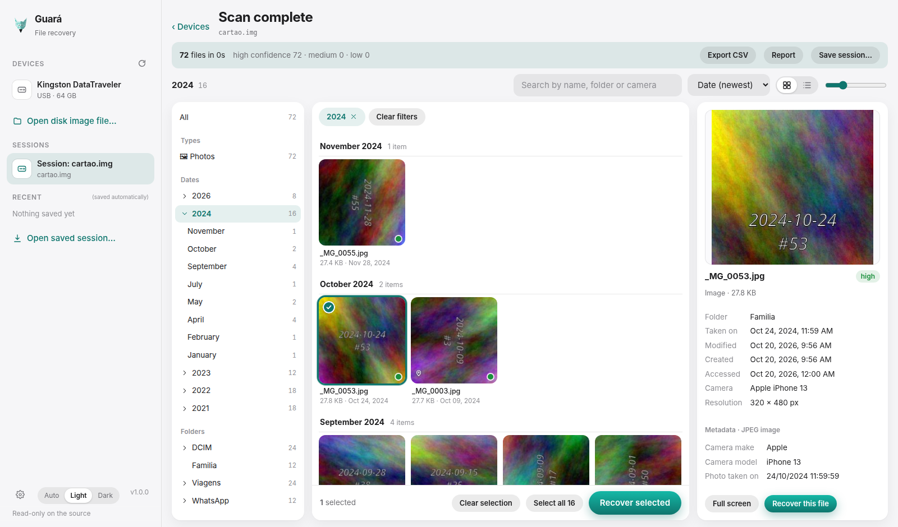
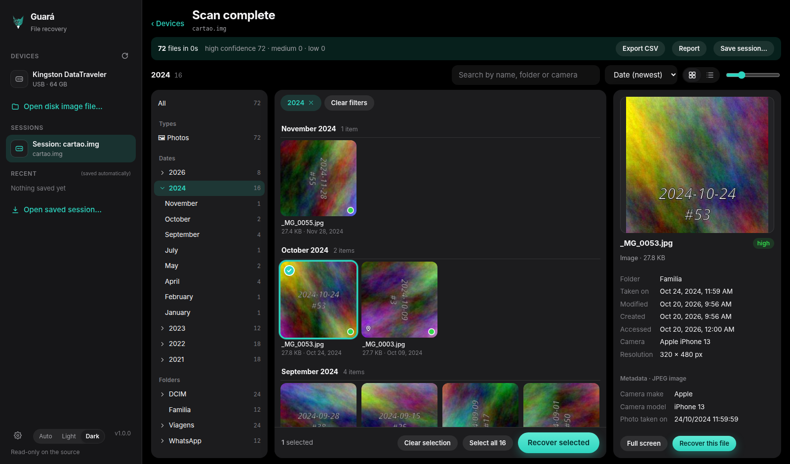
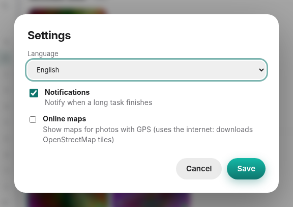

<p align="center"></p>
<h1 align="center">Guará</h1>
<p align="center">Free file recovery for hard drives, SSDs and USB sticks.<br>Terminal and graphical interface · Windows, Linux and macOS · read-only on the source.</p>

<p align="center"><a href="docs/support.md">What it supports</a> · <a href="docs/interface.md">Interface</a> · <a href="docs/cli.md">Terminal</a> · <a href="docs/architecture.md">Architecture</a> · <a href="ROADMAP.md">Roadmap</a> · <a href="CHANGELOG.md">Changelog</a></p>

<p align="center"><b>English</b> · <a href="README.pt-BR.md">Português</a></p>

<p align="center"><br><sub>The real interface running on a synthetic test image (generated photos, no real data).</sub></p>

---

In a single scan, Guará does what tools like Recuva, PhotoRec, TestDisk and Disk Drill do separately:

- **File system metadata:** finds deleted files **with name, folder and date** on NTFS, FAT12/16/32, exFAT, ext2/3/4, HFS+, Btrfs and APFS (on XFS only the content comes back, by carving, see below).
- **Structure-aware carving** in free space, damaged partitions and unpartitioned space. The detectors read the real structure of dozens of formats to learn the **exact size** and a **confidence** level.
- **Encrypted volumes:** opens BitLocker, LUKS and FileVault 2 with your password or key and scans inside.
- **RAID and LVM:** reassembles arrays from loose disks (RAID 0, 1, 4, 5, 6, 10, LVM2), working out level, stripe size and order by itself when there is no metadata.
- **Fragmented files:** reassembles JPEGs stored in pieces and rebuilds the index of MP4/MOV videos that lost their `moov`.
- **Forensic images:** reads and writes raw images, **E01/Ex01** and **AFF4**, and reads **QCOW2, VMDK, VHD, VHDX** and **DMG** virtual disks.
- **Lost partitions:** reads MBR/GPT and searches for volumes by signature where the table failed.
- **Merge without duplicates:** a file found by more than one method appears once, with the best evidence.
- **Per-file confidence** (high, medium, low): intact structure, reused clusters, zeroed content (TRIM) or content that does not match the extension.

The full matrix, with the limits of each item, is in [docs/support.md](docs/support.md).

## Data safety

- The source is opened **read-only**. Nothing in the core writes to the device being recovered.
- Recovery **refuses destinations on the same disk** as the source (Linux and macOS).
- **Forensic imaging** tolerates bad sectors, with an error map and hash: always work on the copy of a failing disk.
- Every recovery writes `guara-manifesto.json` with the **MD5, SHA-1 and SHA-256** of every file.
- **Passwords are never written to the session file.**

## Installation

Download the package for your system from **[Releases](../../releases)**:

| | CLI | Graphical app |
|---|---|---|
| Windows | `guara-*-windows-x86_64.zip` | `.msi` / `.exe` installer |
| macOS | `guara-*-macos-{aarch64,x86_64}.tar.gz` | `.dmg` |
| Linux | `guara-*-linux-{x86_64,aarch64}.tar.gz` | `.AppImage` / `.deb` |

Every file has a `.sha256` next to it. To build from source: `cargo build --release -p guara-cli` (Rust 1.80+).

**Updates:** the desktop app (AppImage, Windows and macOS) checks GitHub for a newer version when it opens; if there is one, a card offers **Update now**: it downloads, verifies the package signature, installs and reopens, so you no longer swap the AppImage by hand. The check is a single request for the release's `latest.json` and nothing of yours is sent; turn it off in **Settings**. Installs from `.deb`/`.rpm` only show the notice, because the package manager owns those files.

> The binaries are **not signed yet**: Windows SmartScreen and macOS Gatekeeper will warn you. Check the SHA-256.

Reading raw disks requires privileges: **administrator** (Windows), `sudo` (Linux and macOS). Even as root, Guará writes sessions, reports and recovered files with the owner and permissions of the user who launched it.

There is also a Docker image of the command line tool, for Linux hosts and for working on image files: see [docs/docker.md](docs/docker.md).

## Getting started

```bash
sudo guara devices                                  # which disks exist
sudo guara scan /dev/sdb --session s.json --list    # deep scan
guara recover s.json /mnt/other-disk/Recovered      # recover, onto ANOTHER disk
```

Failing disk? Make the image first and work on the copy:

```bash
sudo guara image /dev/sdb /mnt/other-disk/sdb.img
guara scan /mnt/other-disk/sdb.img --session s.json
```

Other commands (`inspect`, `health`, `hash`, `search`, `export`, `report`, `verify`, `ui`, encrypted volumes, RAID) are in **[docs/cli.md](docs/cli.md)**.

## Graphical interface

A desktop app (Tauri) in the style of a file manager, designed for when Guará finds thousands of items. The same front end runs in the browser with `guara ui`. More screenshots and details in **[docs/interface.md](docs/interface.md)**.

<p align="center"> </p>

- **Thumbnail grid** or **list**, grouping by day or month and virtual scrolling for tens of thousands of files.
- **Sidebar navigation** by type, real photo date (EXIF), folder, camera, confidence and GPS, with an option to hide duplicates.
- **Finder or Explorer style selection** and full-screen **quick look** (Space, Enter or double click).
- **Details panel** with preview, dates and metadata.
- Fields for password, RAID, reference video and image format; disk health (SMART); pause and resume; Auto, Light and Dark themes; interface in English and Portuguese, chosen in Settings.

**Preview before recovering**, read straight from the disk without writing anything: images, video, audio, PDF, text, Word/Excel/PowerPoint/OpenDocument, ZIP contents, **SQLite databases** (with deleted rows) and hex. On Linux, video playback depends on the `gstreamer1.0-libav` and `gstreamer1.0-plugins-good` plugins; without them, the "Open in system player" button covers the case.

## Forensic features

- **Hashes** MD5, SHA-1 and SHA-256 of every recovered file, of the image and of the device.
- **Metadata:** EXIF (camera, lens, serial number, GPS), PDF, Office and OpenDocument, MP4/MOV.
- **Timeline:** creation, modification and access dates from NTFS, FAT and exFAT.
- **Text search across the whole disk**, including free space, in UTF-8 and UTF-16.
- **CSV** (opens in Excel) and a printable **HTML report** with case, examiner, source, partitions, summary and hashes.
- **Automatic sessions** and reconnection: Guará recognizes the same disk coming back under another name.
- **Duplicate detection** by content signature.

> **Warning:** Guará has **not been externally validated** yet (for example, in the NIST CFTT tests) and has no trusted timestamp (RFC 3161) on its signatures. It is well suited to recovery and triage; for use in court, check the results by other means. The path to get there is in the [ROADMAP](ROADMAP.md).

## Known limits

- **Overwritten data does not come back.** On an SSD with TRIM the disk may zero deleted blocks; Guará warns you, but it cannot work miracles.
- **Fragments:** only JPEG (up to three pieces) and MP4 without an index are reassembled. Other formats, if fragmented, come out truncated with low confidence.
- **ReFS and Storage Spaces** are not supported (ReFS is only detected).
- **XFS:** on a real XFS (v5, kernel deletion) the inode and its extent list are wiped, so Guará recovers the **content** of files with a recognizable structure by carving, but not their name or folder; reading names needs the file system journal, which is not implemented. The old inode-based path only works on simulated deletions. **APFS:** deletion recovery tested only in simulation.
- **NTFS:** compressed files, EFS and heavily fragmented records are skipped or marked as incomplete.
- **exFAT:** validated with a synthetic image; real media are still missing.
- **Phones:** Guará works with storage media and does **not** unlock devices or bypass passwords.
- **Windows and macOS:** the code builds and is tested in CI, but the tests with real images run only on Linux. Reports from real media are very welcome.
- **GUI:** on Linux and macOS the app restarts entirely as administrator (`pkexec` or `osascript`) instead of using a helper process.

## Where it is going

Summary of the [ROADMAP](ROADMAP.md):

| | |
|---|---|
| **Done** | Metadata from 8 file systems, BitLocker, LUKS, FileVault 2, RAID, LVM, E01, Ex01, AFF4, fragmented JPEG, MP4 without an index, SQLite reader, SMART, QCOW2/VMDK/VHD/VHDX/DMG, hash-chained audit trail, PDF report, Ed25519 signatures, APFS free map |
| **Next** | Trusted timestamps (RFC 3161), tests on Windows and macOS |
| **Later** | NSRL and hash lists, content search, unified timeline, browser interpretation, Windows registry and messaging apps, dictionary and brute-force attacks on encrypted volumes |
| **No reference image** | ReFS and Storage Spaces: they only land with validation |
| **Long term** | iOS and Android backups (iTunes, ADB), OCR, NIST CFTT validation, physical phone access through bootloader/chip exploits |

## Development

```
crates/guara-core   core: reading, partitions, file systems, encryption, RAID, carving, recovery
crates/guara-cli    `guara` binary (CLI + local UI server)
apps/gui            interface (ui/ = HTML, CSS and JS; src-tauri/ = desktop app)
scripts/            test images and reference data
docs/               support, terminal and architecture
```

```bash
cargo test --workspace        # on Linux this builds real images with mtools, ntfs-3g, e2fsprogs
scripts/fetch-testdata.sh     # optional: reference images (BitLocker, FileVault 2, dfvfs, AFF4)
cargo clippy --workspace --all-targets
```

See [CONTRIBUTING.md](CONTRIBUTING.md) and [docs/architecture.md](docs/architecture.md). Versions follow [SemVer](https://semver.org/); changes are in [CHANGELOG.md](CHANGELOG.md). To publish: `git tag vX.Y.Z && git push --tags` (the `release` workflow builds and publishes everything). Vulnerabilities: [SECURITY.md](SECURITY.md).

## License

[MIT](LICENSE-MIT) or [Apache-2.0](LICENSE-APACHE), at your option.
