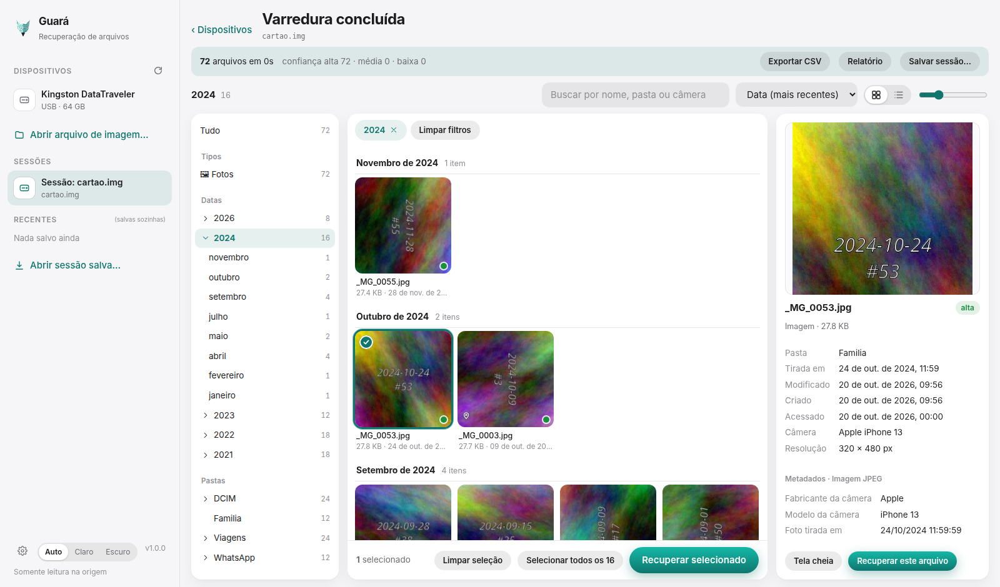
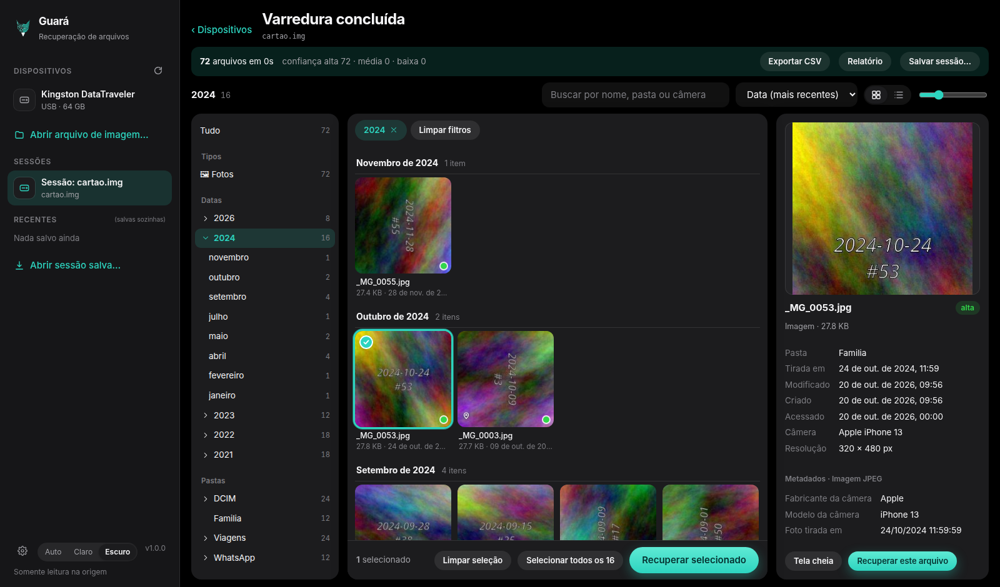
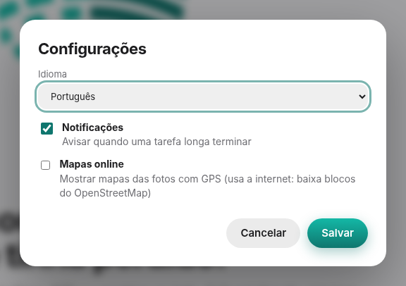

# Interface gráfica

[English](../interface.md) · **Português**

O Guará tem um app desktop (Tauri) e o mesmo front-end no navegador com `guara ui`. Tudo o que está abaixo existe nos dois.

## O explorador

Depois da varredura, os resultados abrem num explorador no estilo de um gerenciador de arquivos, pensado para milhares de itens:

- **Esquerda:** navegação por tipo, data real da foto (EXIF, por ano e mês), pasta, câmera, confiança e GPS, com opção de ocultar arquivos pequenos e duplicadas.
- **Centro:** grade de miniaturas ou lista, agrupadas por dia ou mês, com rolagem virtual. Uma etiqueta mostra o filtro ativo e o remove com um clique.
- **Direita:** painel de detalhes com a pré-visualização, pasta, datas (tirada, modificada, criada, acessada), câmera, resolução e os metadados do arquivo. O selo mostra a **confiança** do arquivo (alta, média ou baixa).
- **Barra inferior:** quantidade selecionada e os botões de recuperação. A recuperação sempre vai para outra pasta e grava um manifesto com MD5, SHA-1 e SHA-256.

As setas navegam pelos arquivos e a barra de espaço abre a visualização rápida em tela cheia. A seleção funciona como no Finder ou no Explorer (Ctrl, Shift e teclado).

## Temas

O seletor no fim da barra lateral oferece **Auto** (acompanha o sistema), **Claro** e **Escuro**. A escolha fica salva.

## Idioma

Em **Configurações** (a engrenagem no fim da barra lateral) há o seletor **Idioma**: **Auto** acompanha o idioma do sistema, ou você escolhe **Português** ou **English**. A troca vale na hora. A mesma janela controla as atualizações automáticas (abaixo), as notificações de tarefas longas e os mapas online das fotos com GPS (desligados por padrão, porque baixam blocos do OpenStreetMap).

## Atualizações

Ao abrir, o app desktop pede ao GitHub o `latest.json` da release. Havendo versão mais nova, aparece um cartão no canto inferior direito com as versões, **Novidades** (as notas do CHANGELOG) e **Atualizar agora**. O app baixa o pacote, confere a assinatura com a chave pública embutida nele, instala e reabre sozinho. No Linux isso vale para o AppImage (o arquivo é substituído no lugar); instalações por `.deb` ou `.rpm` só mostram o aviso com o endereço da release. **Configurações > Atualizações automáticas** desliga a verificação ao abrir e tem o botão **Verificar agora**. A consulta não envia nada além do que qualquer navegador envia ao GitHub. O `guara ui` no navegador não se atualiza sozinho.

As mensagens de erro que vêm do núcleo e a saída do terminal continuam em português.

## Sobre estas telas

Mostram a interface de verdade, não uma maquete, rodando sobre uma imagem de teste sintética: 72 JPEGs gerados com EXIF falso (câmeras, datas, GPS), apagados de uma imagem FAT32 por `scripts/make-photo-fixture.py` e encontrados por um `guara scan` normal. Nenhum dado real aparece. O nome do dispositivo na barra lateral foi trocado por um genérico.
